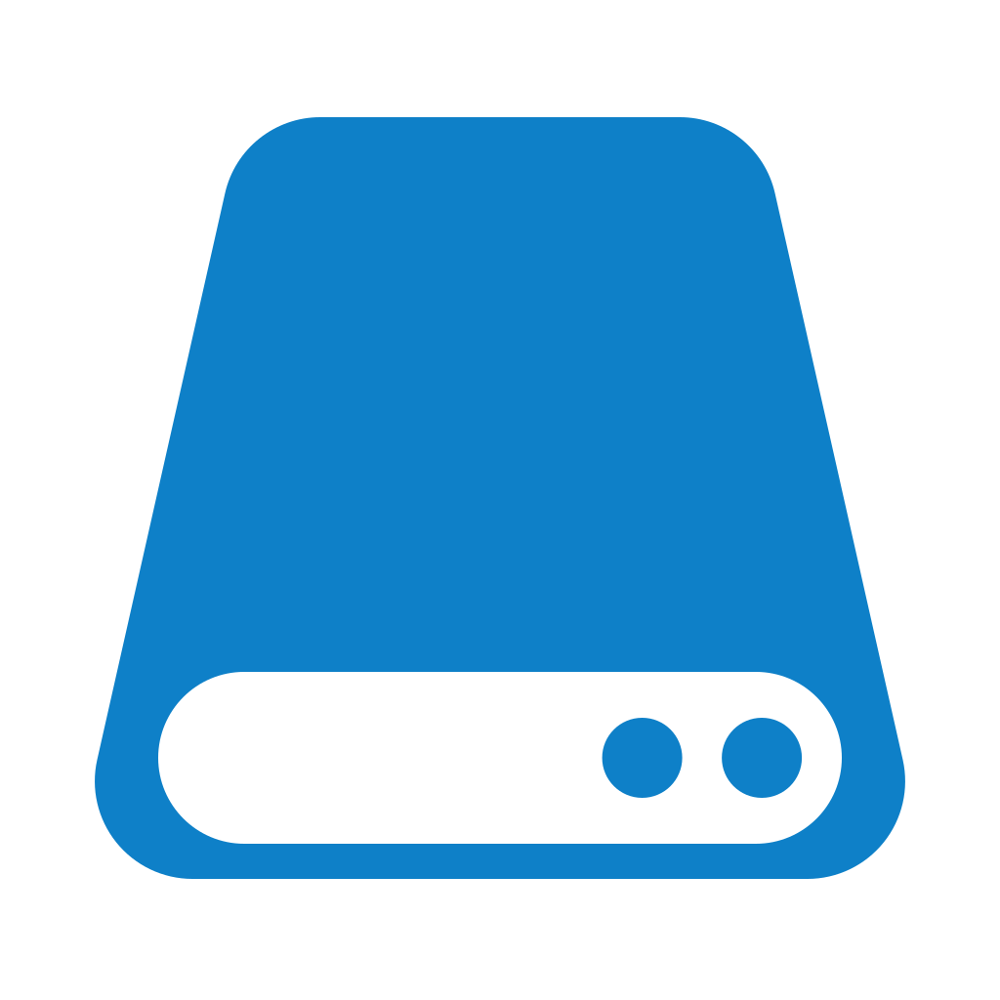

<div align="center">
  
  <h1>Wails v3 Vue shadcn Template</h1>
  <p><strong>Wails v3 官方模板体系的社区模板：Vue 3 + TypeScript + Vite + shadcn-vue + Tailwind CSS v4。</strong></p>
  <p>托盘常驻 · 单实例 · 开机自启 · 三平台安装包 CI · 开箱即用的工程实践</p>
  <p>
    <a href="LICENSE"></a>
    <a href="https://v3.wails.io"></a>
    <a href="https://vuejs.org"></a>
    <a href="https://ui.shadcn.com"></a>
    <a href="#platform"></a>
  </p>
  <p>
    <a href="#features">模板特性</a> ·
    <a href="#quickstart">使用方式</a> ·
    <a href="#structure">仓库结构</a> ·
    <a href="#how-it-works">模板机制</a>
  </p>
</div>

<br/>

<a id="features"></a>

## ✨ 模板特性

初始化出的项目开箱即用：

- **🧩 Vue 3 + TypeScript + shadcn-vue**：Vue 3.5 + Vite 8 + TypeScript，组件库 shadcn-vue（reka-nova 预设）+ Tailwind CSS v4，图标 lucide，提示 vue-sonner，主题跟随系统 / 浅色 / 深色。
- **🖥️ 托盘常驻**：关闭窗口只是隐藏到托盘，程序后台运行；双击托盘恢复主界面；开机自启时带 `--tray` 静默进入托盘。
- **🔒 单实例**：生产构建（`-tags production`）只允许一个实例，重复启动把已有窗口带到前台；开发构建不限制多开。
- **🚀 三平台开机自启**：`SettingsService.SetAutoStart` 开关，Windows 注册表 / macOS LaunchAgent / Linux autostart desktop 三件套。
- **📦 三平台打包与 CI**：`task package` 一键 NSIS / MSIX、.app / .dmg、AppImage / deb / rpm / AUR；推送 `v*` tag 自动三平台构建发布 Release。
- **🎨 图标自生成**：仓库内置纯标准库图标生成器（`build/tools/icon`），改几行几何参数即可产出全套品牌图标。
- **🤖 Agent Skills**：内置提交信息规范 skill（`.agents/skills/commit`，Conventional Commits + 固定类型图标），Kimi Code / Claude Code 等 agent 提交代码时自动遵循。

<a id="quickstart"></a>

## 🚀 使用方式

```bash
# 使用本模板创建新项目（需要 Wails v3 CLI）
wails3 init -n MyApp -t https://github.com/younland/wails3-vue-shadcn-template
cd MyApp

# 工具链由 mise 锁定并一键安装（Go 1.27 / Node 26 / pnpm 11 / Task）
mise install
mise exec -- pnpm install --dir frontend

task dev        # 开发：前端热更新 + Wails 绑定自动生成
task build      # 生产构建（产物在 bin/）
task package    # 打包安装包
```

生成的项目带有一份详尽的 `README.md`（应用截图占位、平台功能说明、版本号与图标替换、发布流程、Roadmap 等），按提示替换产品信息与图标即可。

<a id="structure"></a>

## 📁 仓库结构

这是模板仓库本身，与生成出的项目一一对应：

```
├── template.yaml           # 模板元数据（名称 / shortname / 描述 / wailsVersion）
├── *.tmpl                  # 参与变量替换的模板文件（Go text/template）
├── main.go.tmpl            # 应用入口：窗口、服务注册、单实例、托盘
├── tray.go.tmpl            # 系统托盘与托盘菜单
├── greetservice.go         # 示例服务：Greet，演示前后端调用
├── settingsservice.go      # 设置服务：主题 / 开机自启 / 版本号
├── appinfo.go.tmpl         # appID（系统层唯一标识，Windows 即 AUMID）
├── appid_windows.go        # Windows 启动时设置进程 AUMID
├── update.go               # appVersion 默认值（ldflags 注入点）
├── autostart_*.go          # 开机自启四件套（windows / linux / darwin / other）
├── singleinstance*.go      # 单实例三件套（shared + production + !production）
├── frontend/               # Vue 3 源码（package.json 等同样为 .tmpl）
├── build/                  # 构建资产与纯标准库图标生成器
├── .github/workflows/      # 三平台打包 + Release 发布（release.yml）
├── mise.toml               # 工具链版本锁定
└── Taskfile.tmpl.yml       # 顶层任务定义
```

<a id="how-it-works"></a>

## 🧪 模板机制

- 文件名以 `.tmpl` 结尾的文件在 `wails3 init` 时按 Go `text/template` 语法替换变量（如 `{{.ProductName}}`、`{{.BinaryName}}`）并去掉 `.tmpl` 后缀；不带 `.tmpl` 的文件原样拷贝。
- 变量集由 `template.yaml` 声明的模板元数据与 Wails v3 产品信息（项目名、二进制名、描述等）共同提供。
- 仓库根目录不放 `README.md` 的模板产物时，`README.md.tmpl` 会生成新项目的说明文档；本文件是模板仓库自身的说明，不会进入新项目。

<a id="license"></a>

## 📜 开源协议

本项目基于 [MIT](LICENSE) 协议开源。
